# The Breakcore Bugle - September/October 2026 Edition

Hello hello my Buglers! Toot toot! It's been a while...

Apologies about that, I was very slammed in September, quite burnt out and unmotivated, so I postponed the September release. I don't want to do these roundups if I feel like I'm half arsing them, so I'd rather wait a month and bundle 2 months together :)

Lucky 4 u... Now we have a CHONKY edition of the Bugle, so sit down, get comfortable, you may be here mesmerised by breaks of all shapes and sizes for quite some time...

## Releases of the month

Without further ado, the releases that have rocked my proverbial boat the most over the last couple of months...

### Legoshi - Croquet

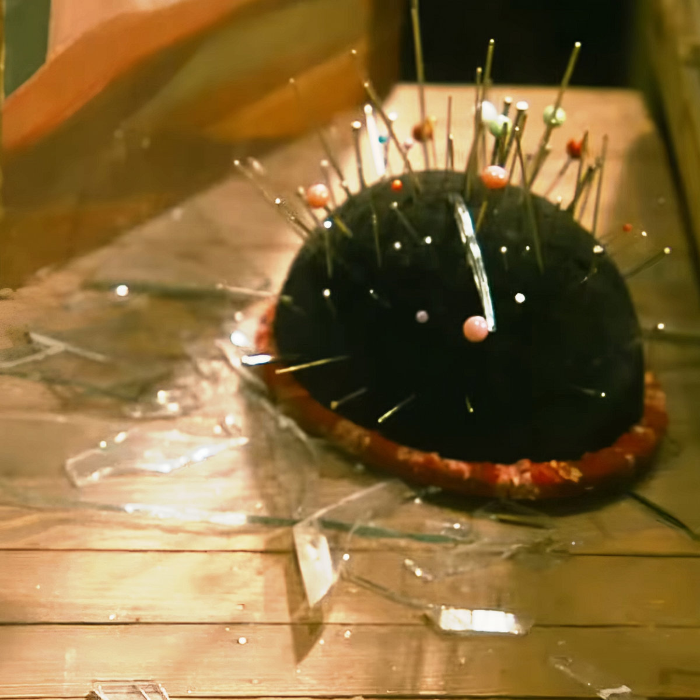

Oh yeah. I love the Bandcamp feature where you get to see in your feed what people you are following have bought. If not for that, I would've never discovered this wonderful & weird album.

Atmospheric, with raw, gritty breaks. Despite the breaks being incredibly complex, they still feel very real, and I can hear the original performance in them still. A stylistic choice with breaks, but one I love. I prefer breaks to sound like this rather than super processed.

Weird, interesting & varied samples and instruments. This album is a pensive and, at times, uncomfortable experience. In the best of ways.

Buy it on [Bandcamp](https://legoshi.bandcamp.com/album/croquet)!

### MistakenCastle - the crushing weight of existence

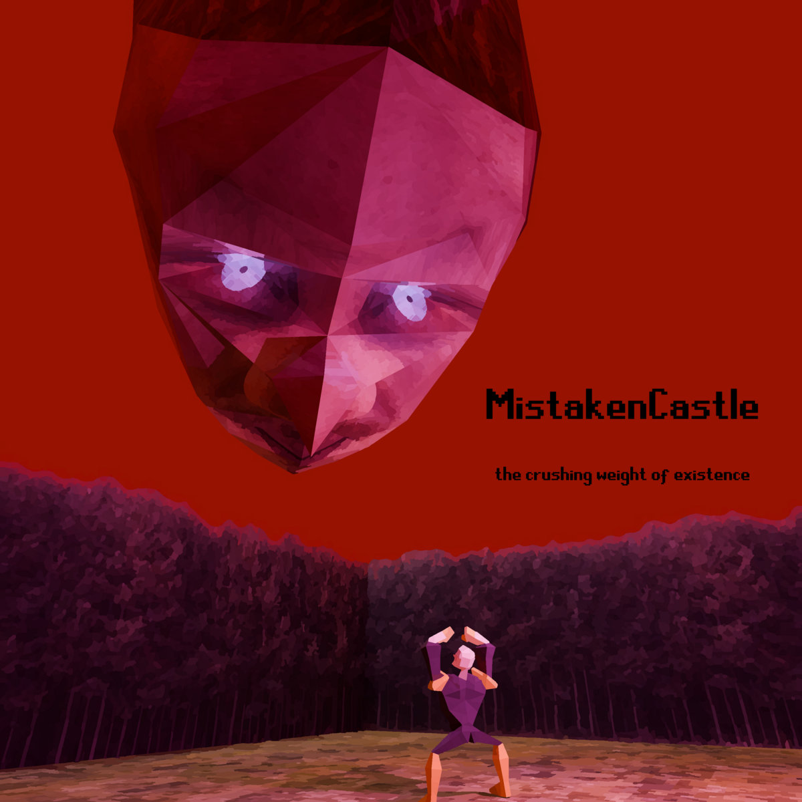

Ohhhhh yessssss, every MistakenCastle release is such a treat.

They're again bringing you their desconstructed ethereal beats, superb production & complex yet seamless instrumentation. Sick ultra processed vocals as always also.

I really love their vocal sampling/performance (I honestly can't tell which it is) style. This whole EP feels like being subjected to the ramblings of a mad god inside a sadistic video game. I am powerless to do all but witness...

Buy it on [Bandcamp](https://mistakencastle.bandcamp.com/album/the-crushing-weight-of-existence)!

### Low Entropy - Antares (The Nucleus Project: Scorpii Nox)

Chaotic & mad assault on your senses. Unrelenting and powerful from start to finish. Leans heavy into the noisier side of breakcore, the breaks in this one are absolutely filthy to the point of almost being unrecognisable. I love it. Repetitive, mesmerising, foul & putrid. This 2 track (which is part of a full album to be released early 2027) really just says fuck you.

Buy it on [Bandcamp](https://lowentropy.bandcamp.com/album/antares-the-nucleus-project-scorpii-nox)!

### Skeeter, Crushkill - Card020 Riker Vs. Picard

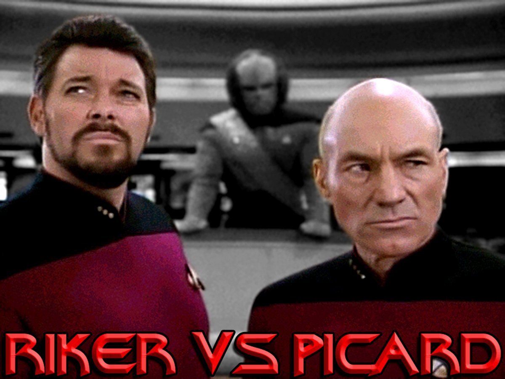

This 2 track was technically originally released July 14th, 2005. However it got uploaded to Bandcamp just the other day, so I'm including it, especially with the recent passing of Sir Patrick Stewart.

This EP is super old school breakcore, repetitive addictive beats, crushed just up to the point of being too delicious. Atmospheric & relaxing, but still super dancy and upbeat, with great sampling. Wonderful lead lines, with delicate synths dancing on top of the filthy breaks. Perfect.

I'm massively biased, of course. I'm a huge trekkie. Star Trek TNG quite literally defined who I am as a person - without binge watching it at 19 years old I would not be who I am today, at all.

TNG's success is largely attributed to Patrick Stewart's passion and dedication. The show nearly failed several times in the first couple seasons.

Without Stewart's dedication and passion for his craft, TNG would not have lasted longer. And if it had not, I would've likely never watched it, my life would probably be completely different, and there would likely be no Bugle right now.

So, I've taken a little chunk out of this month's rundown to pay homage and mourn an idol of mine, and discovering this 2 track EP couldn't have come at a better moment. Walter Koenig, the actor who played Pavel Chekov in the original series, also passed away recently, another great loss. Darmok and Jalad, on the ocean!

Buy it on [Bandcamp](https://heresmycardrecords.bandcamp.com/album/card020-riker-vs-picard)!

### gl00m13 - REACTCD:014 REALITY SIGNAL PROCESSOR

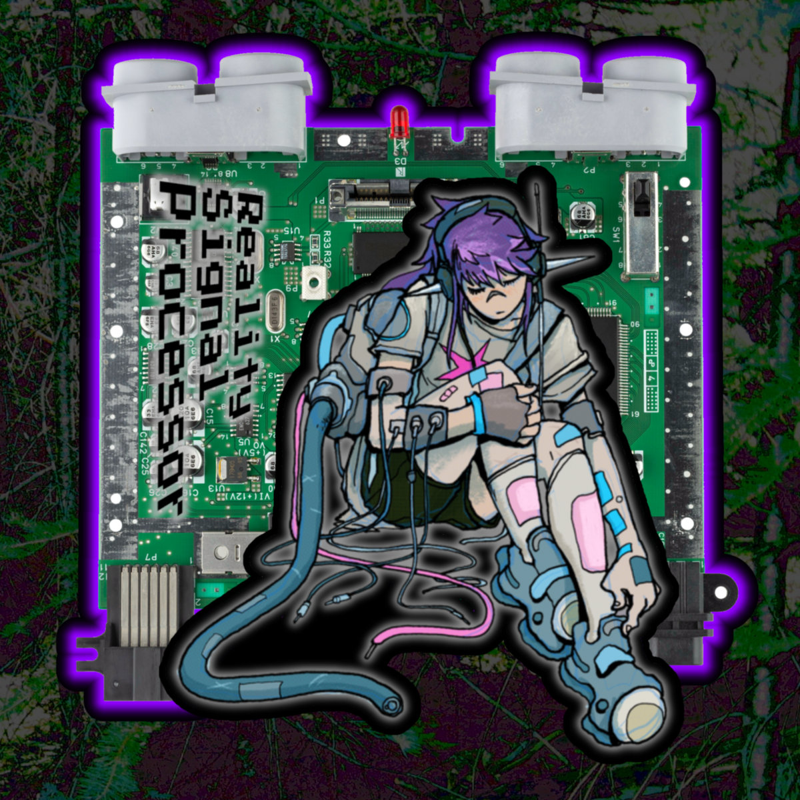

Deeply atmospheric, layers and layers of wonderful sound design throughout this album. Very cool sampling and textures. Lighter on the breaks than the earlier entries in this list, but a relaxing, mesmerising, and perplexing take on breakcore that I get very easily lost in.

A final compliment, this feels like an incredibly carefully assembled album. Aesthetically consistent from the visuals to the music at every level. It's an experience. This album feels like gl00m13 really put their soul into it. Love it.

inb4 any "muh this isn't technically breakcore!", idc, this is also not a democracy. Anything breakcore-adjacent may go into the Bugle :)

Buy it on [Bandcamp](https://reactionary.bandcamp.com/album/reactcd-014-reality-signal-processor)!

### Autopsy protocol - FIT

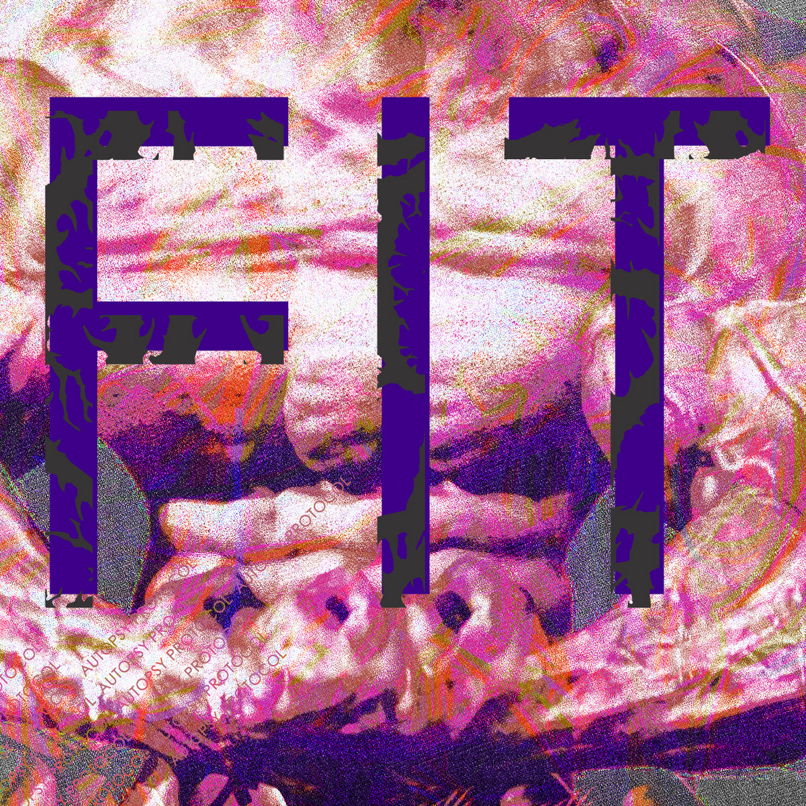

Ultra processed absolutely filthy breaks. Dancey and extremely energetic. Bouncy, aggressive and unrelenting. Absolutely crispy clean production crispier than a super ripe and juicy apple. Keeps you hooked from start to finish. Very cool instrumentation & sampling too.

Buy it on [Bandcamp](https://dayofthedroids.bandcamp.com/album/fit)!

### SKRD4EVER - V.A. - SUPER KICK RAVE DISASTER!!!

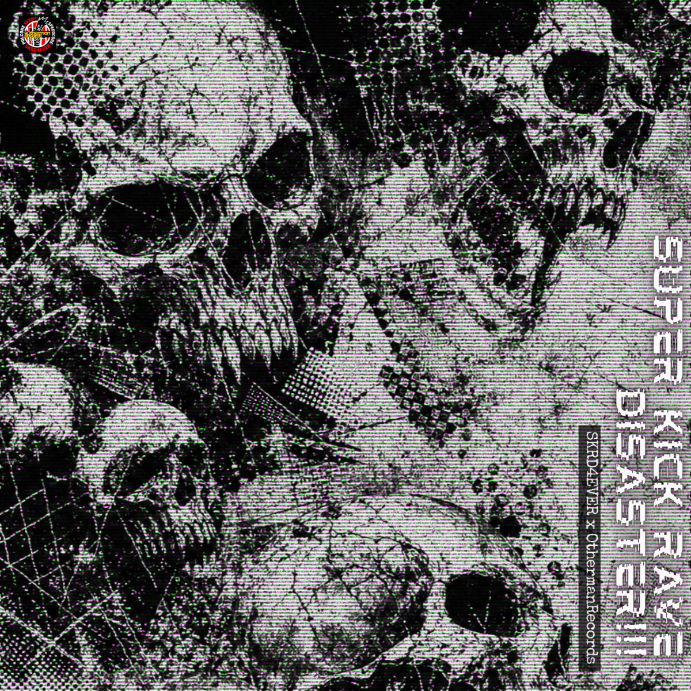

Compilation album brought to you by Super Kick Rave Disaster & Otherman Records, two of the best labels out there pumping out high quality breakcore, so you know this comp is stacked with talent and heat!!!

With releases from some former Bugle featurees & favourites:
- Tomoyu
- Odaxelagnia
- Shoebill
- Qvasny

And more, you know this comp is hard.

Buy it on [Bandcamp](https://skrd4ever.bandcamp.com/album/v-a-super-kick-rave-disaster)!

### Swr.ratGRL - POWERSLAVE

High energy, super dancey and fun breakcore, Swr.ratGRL's blown out in your face sound in full force and full effect throughout the album. This album is so much fun front to back.

Buy it on [Bandcamp](https://tami-tomi.bandcamp.com/album/powerslave)!

### neiN - Putain D'Poutine

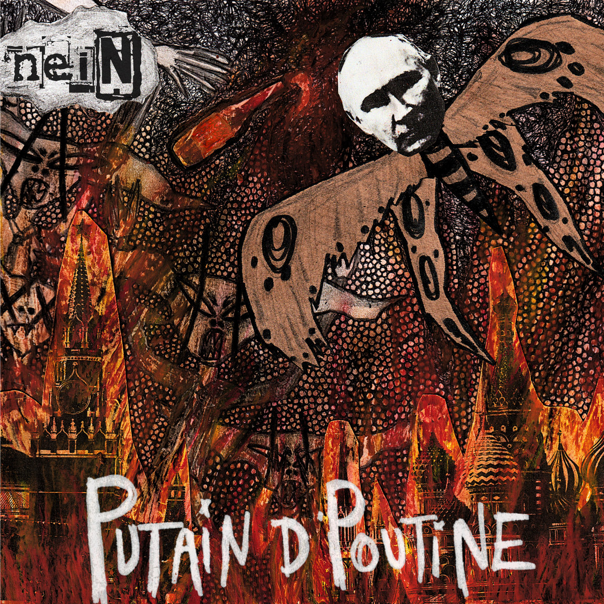

Fiiiiiiiiilllllllllthyyyyyyyy breakcore/grindcore...

> neiN unites Marc Hell (vocals), Mr Bengle (guitar), and Deepa Reptile (breakcore) — three musicians smashing together metal grit and heavy breakcore production.

Together they make a delicious little cocktail I want to sip on for the rest of time... This album is so aggressive and blends genres very well. The riffs and the breaks go hand in hand so perfectly.

Buy it on [Bandcamp](https://suckpuckrecordz.bandcamp.com/album/putain-dpoutine)!

### Starmoon - Now That's What I Call Breakcore!

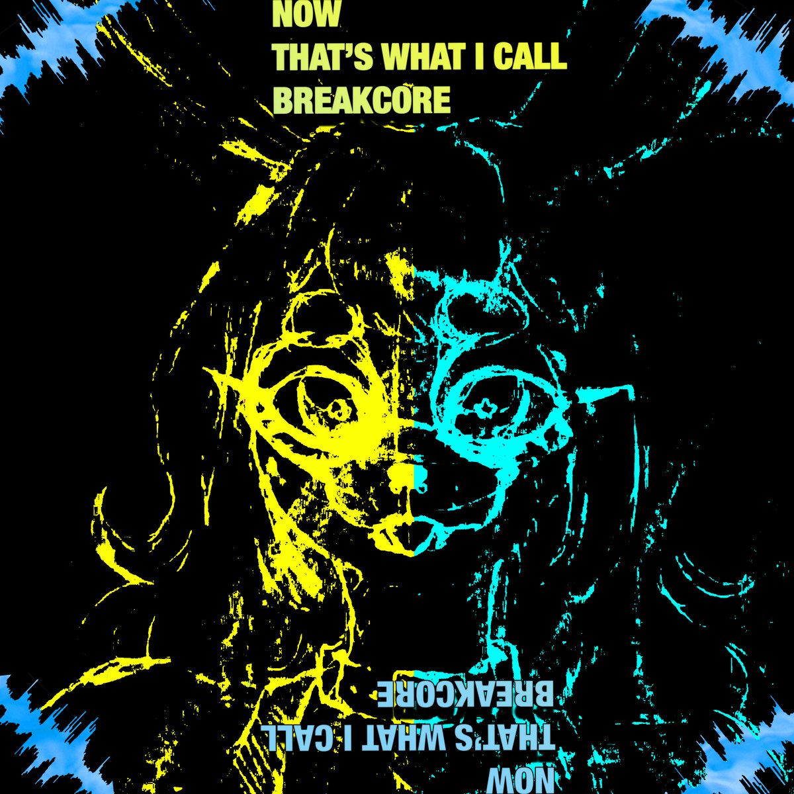

Crazy craaaaaaaaaazy noisy but crisp breaks layered with enticing melodies and rhythms. Each track has it's own flavour, but still stays belonging in the EP. Track 3 samples what sounds like some classical guitar, while track 1 is certified for the dance floor, track 2 is a perfect mess of fucked up beats and ethereal synths, whilst track 4 has different moments that encompass all of these vibes. This EP feels really personal and carefully crafted. It's wonderful.

Buy it on [Bandcamp](https://dogpunk.bandcamp.com/album/now-thats-what-i-call-breakcore)!

### MicroFreeq - Dead Dead Demons

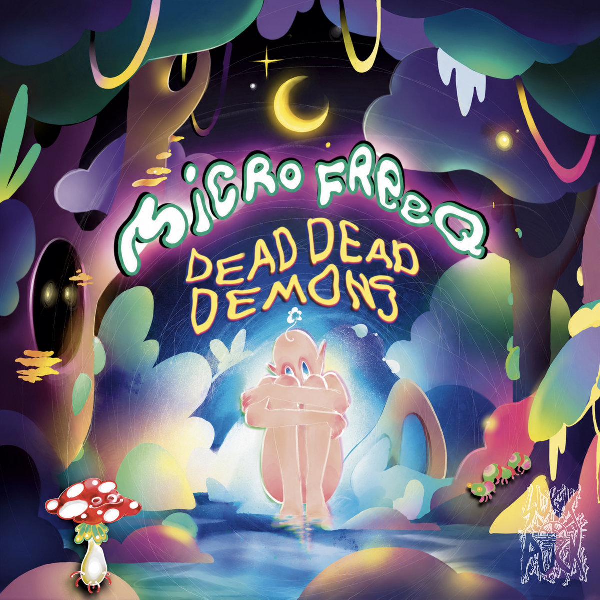

Phenomenal debut EP from MicroFreeq here, idm/breakcore at its finest. The percussion is so intricate and hypnotising, and the production on top of the percussion is squeaky clean. Eerie, beautiful, melancholic.

Buy it on [Bandcamp](https://suckpuckrecordz.bandcamp.com/album/dead-dead-demons)!

### Missilehead - State of Mine EP

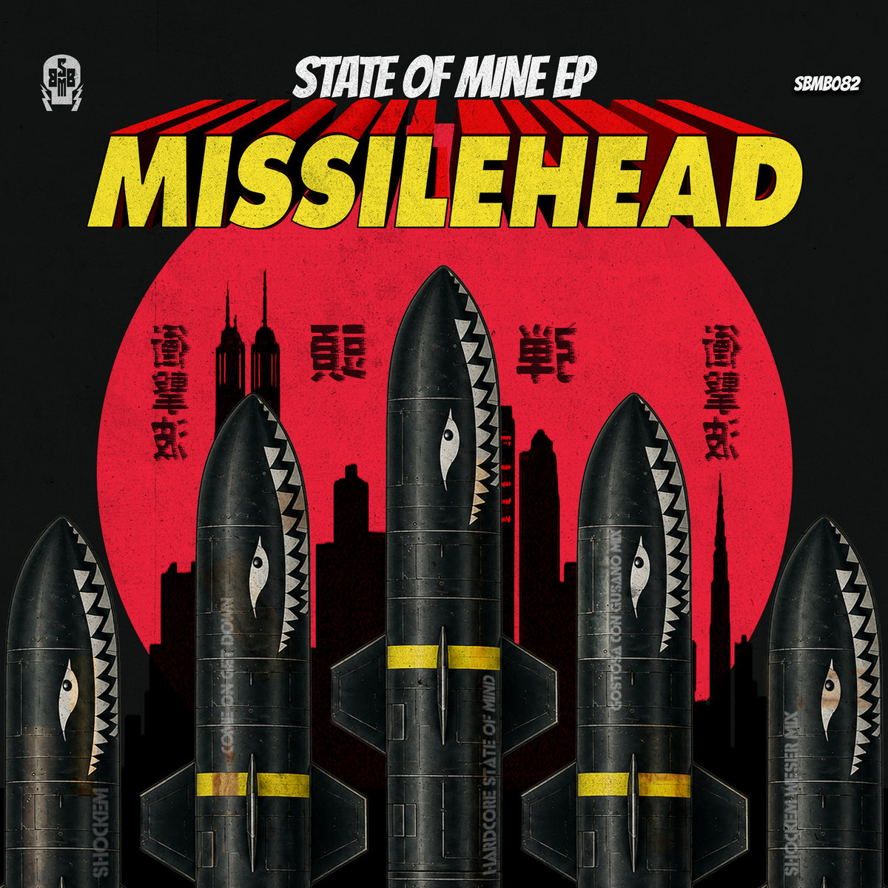

Hard as FUCK old school hardcore/gabber. I'm quite picky with hardcore & gabber, but this EP hits the spot front to back. Super aggressive and raw, just how I like it. Perpetual dirty kick in ya face!! Kickass sampling too. Definitely going to play this one out at some point.

Buy it on [Bandcamp](https://superbadmidibreaks.bandcamp.com/album/state-of-mine-ep)!

## Singles of the month

And without further ado, singles of the month? Make it so...

### wawawa - bear (remix)

Every wawawa track I hear blows my fucking mind. I really think wawawa is leading the charge in whatever you want to call their brand of breakcore, I don't really hear many other artists achieving this wonderful balance of raw sounding vs processed breaks, as well as this perfect balance of complexity & danceability. It's hard as fuck to do and wawawa has mastered it.

Listen on [SoundCloud](https://soundcloud.com/wawarushi/bear-remix)!

### Demetzy - Kurt was a feminist

A wonderful fucked up and crazy remix of Nirvana's "Rape Me", interlaced with samples from interviews with Kurt Cobain. This track is absolutely wonderful & brutal. The textures are so unique, something I always enjoy from Demetzy's tracks. Total sonic assault on ya earballs!!!

Listen on [SoundCloud](https://soundcloud.com/demetzy/kurt-was-a-feminist-v2)!

### Day of the droids - ワッペリン - 世界のはじまりごっこ / Autopsy protocol REMIX

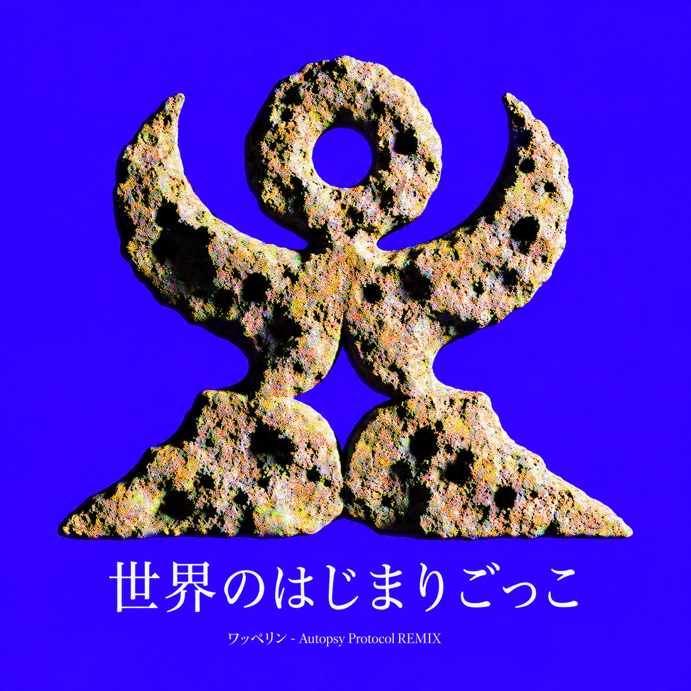

Another entry from Autopsy protocol, a very bouncy and extremely fun listen, kookie little lead lines, transitioning into filthy kicks later on...

Listen on [Bandcamp](https://dayofthedroids.bandcamp.com/album/autopsy-protocol-remix)!

### Shoebill - chez burger

Shoebill the reigning regent of mashcore back at you again. Wildest of wild rides as always.

Listen on [SoundCloud](https://soundcloud.com/user-905888909/chez-burger)!

### Ruby My Dear - Siamo Tutti

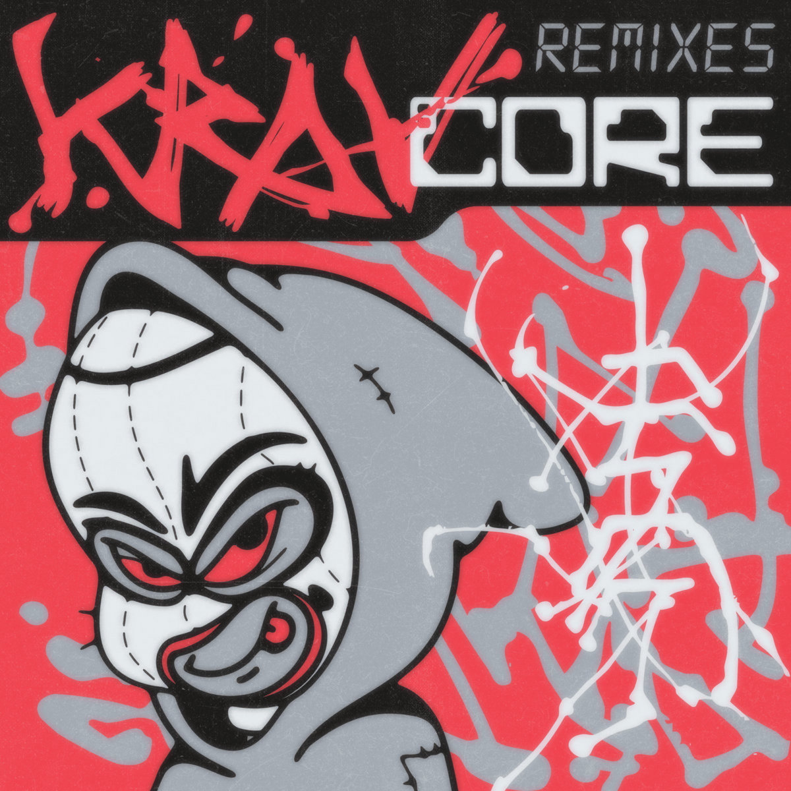

New Ruby My Dear, and that's really all I need to tell you, isn't it, you little breakcore worm, you already know.

Listen on [Bandcamp](https://rubymydear.bandcamp.com/track/siamo-tutti)!

## Thanks!

FUCK YEAH THANKS FOR READING YET AGAIN!!!!

SORRY AGAIN ABOUT THE DELAY !!! It WILL probably happen again at some point lol but I'll do my best to make sure that isn't the case :)

Love ya all means the world people read my breakcore ramblings :') <3

BREAKCORE. BREAKCORE. BREAKCORE. BREAKCORE. BREAKCORE. BREAKCORE. BREAKCORE. BREAKCORE. BREAKCORE. BREAKCORE. BREAKCORE. BREAKCORE. BREAKCORE. BREAKCORE. BREAKCORE. BREAKCORE. BREAKCORE. BREAKCORE. BREAKCORE. BREAKCORE. BREAKCORE. BREAKCORE. BREAKCORE. BREAKCORE. BREAKCORE. BREAKCORE. BREAKCORE. BREAKCORE. BREAKCORE. BREAKCORE. BREAKCORE. BREAKCORE. BREAKCORE. BREAKCORE. BREAKCORE. BREAKCORE. BREAKCORE. BREAKCORE. BREAKCORE. BREAKCORE. BREAKCORE. BREAKCORE. BREAKCORE. BREAKCORE. BREAKCORE. BREAKCORE. BREAKCORE. BREAKCORE. BREAKCORE. BREAKCORE. BREAKCORE. BREAKCORE. BREAKCORE. BREAKCORE. BREAKCORE. BREAKCORE. BREAKCORE. BREAKCORE. BREAKCORE. BREAKCORE. BREAKCORE. BREAKCORE. BREAKCORE. BREAKCORE. 
